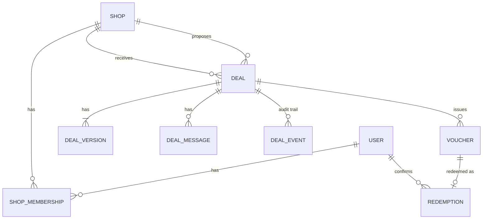

# Architecture

Status: implemented as described, except where marked as not built.

## Shape: one Django monolith

All code lives in one repo and deploys as one unit. Outside services (LLM API, Google sign-in, a geocoding API) are called from this code over HTTPS. Nothing is split into separate services.

```
shopmates/
  manage.py
  shopmates_project/        settings/{base,dev,prod}.py, urls.py, wsgi.py
  accounts/                 shops, staff membership, Google sign-in, approval
  deals/                    deals, versions, messages, vouchers, redemptions, APIs
  ai/
    client.py               the ONLY file that talks to the LLM provider
    prompts.py              prompt templates
    services.py             draft_deal(), suggest_counter(), explain_balance(), playbook_answer()
  templates/                base.html, partials
  static/                   css, js
  docs/
```

## Data model (implemented)



| Model | Key fields | Notes |
|---|---|---|
| `User` | extends `AbstractUser` | Custom user model from day one |
| `Shop` | name, category, address, city, hours, typical_order_value, optional latitude/longitude, status | pending, approved, suspended. Dev auto-approves; prod needs an admin |
| `ShopMembership` | user, shop, role (owner/staff) | MVP: one shop per user |
| `Deal` | proposer, recipient, status, turn, response_deadline, proposer_token, recipient_token | Two UUID tokens, one per shop's QR code |
| `DealVersion` | deal, number, offer_text, discount_percent, redemption_cap, start_date, end_date, terms, created_by_shop | Newest number is current; one set of terms applies both ways |
| `DealMessage` | deal, author, shop, body | Plain text |
| `DealEvent` | deal, actor (null = system), action, note | Audit trail of every transition |
| `Voucher` | deal, referring_shop, honoring_shop, code, expires_at | Created when a customer opens a shop's QR link |
| `Redemption` | voucher (one-to-one), confirmed_by, confirmed_at | The one-to-one is what makes double redemption impossible |

Database constraints: the two shops of a deal differ; version end date is on or after the start; version numbers are unique per deal; one membership per user per shop; unique voucher code; one redemption per voucher.

Where the rules live: `deals/services.py` holds every state change, voucher issue and redemption. Views only translate HTTP into those calls. `deals/forms.py::DealTermsForm` is the single definition of valid terms, used for typed input and for validating AI output.

## Key flows

**Negotiate:** proposer builds a `DealVersion` -> sends -> recipient accepts, counters (creates the next `DealVersion`), or declines. State changes go through one function (`deals/services.py`) that checks the allowed transition and the acting user's role, then writes an audit entry.

**Redeem:** customer GET on the QR URL creates a `Voucher` -> staff of the partner shop POST the code -> the service validates all rules (PRODUCT.md) inside a transaction and creates the `Redemption`. The unique constraint makes double confirmation impossible even under concurrent requests.

## APIs

| Endpoint | Access | Returns |
|---|---|---|
| `GET /api/stats/` | Public | Anonymized aggregates, for example average redemption rate by shop category. Hide any group with fewer than 5 shops (P5). No shop names or addresses. |
| `GET /api/deals/` | Login, own shops only | The caller's deals |
| `GET /api/deals/<id>/redemptions/` | Login, party to the deal | Redemptions with timestamps, no customer data |

Protected APIs return 401 JSON (not an HTML redirect) when logged out.

## Exports

CSV and JSON of a deal's redemptions and summary, for the parties to that deal. Filenames carry a timestamp. JSON includes `generated_at` and `record_count`.

## Security and privacy

- Authorization is checked on every view and API, not just by hiding links. Test that shop A can't read shop B's deals by changing an ID.
- No customer personal data is collected or stored. A redemption is a code, time, shop and staff user.
- CSRF protection on all POST forms. Staff redeem uses POST.
- Secrets only in `.env` / host environment. Production sets `DEBUG=False`, secure cookies, and a required `ALLOWED_HOSTS`.
- Rate limits: per-user on AI calls, per-IP on voucher issuing.
- Uploaded files: none planned. If logos are added later, validate type and size.
- Shop signup is admin-approved so fake shops can't join (open decision #1).

## External services

| Service | Use | Risk |
|---|---|---|
| Google OAuth | Sign-in | Needs both localhost and production redirect URIs |
| LLM API (provider open) | Drafting, counters, explanations | Free-tier limits and host reachability unverified |
| Geocoding API (free, keyless) | **Not built.** Owners can enter latitude and longitude by hand; discover sorts by distance when both shops have them | Add later; reachability from the host is unverified |

## Testing approach

- Unit tests for the transition rules and redemption rules (these are the heart of the app)
- A test that confirming a voucher twice counts once
- A test that cross-shop access is denied
- AI services tested with a fake client; validation tested with bad model output
- Route test that every page and API returns the expected status when logged in and out
